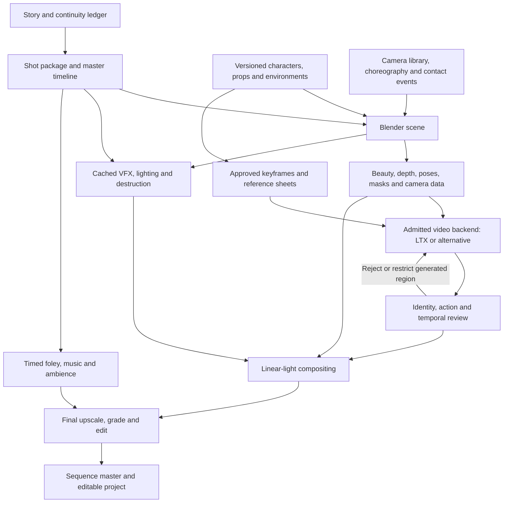

# OneCreations: a locally owned cinematic production system

Research and design decision document • 1 October 2026

> **Archived snapshot (v1).** This is the original research document, kept verbatim as the dated baseline.
> Where it conflicts with `docs/decisions/ADR-0001-hardware-and-compute-strategy.md`, **the ADR wins.**
> Key overrides: the desktop has **32 GB RAM** (not the 64 GB planning minimum below), and the compute strategy is
> **4070-first → H100 only after local admission**, with the ≤ ₹15,000 cloud ceiling retained.

**Scope:** design and research only. No models were installed, no training was run, and no cloud money was spent. Published capabilities below are distinguished from proposed experiments. The RTX 4070 figures are not measurements from your machine.

**Decision in one sentence:** build a Blender-centered production system with reusable characters, choreography, camera paths and timed effects; evaluate LTX-2.5 as a replaceable visual-generation stage, and spend at most ₹15,000 on narrow adapters only after the local workflow earns that investment.

## 1. Executive recommendation

Your strongest advantage is ownership of the scene and its motion. A reusable fight, camera move and effect sequence is more valuable to OneCreations than another interface for generating attractive random clips.

The system should own four things independently of any foundation model: **assets, action, camera and time**. A video model may propose appearance, atmosphere and selected motion details. It must not become the only place where a sword contact, character identity or camera trajectory exists.

I recommend three working modes:

| Mode | What produces the final pixels | Appropriate use |
|---|---|---|
| **Controlled cinematic** — default | Rendered heroes, weapons and important geometry; generated backgrounds or selected appearance layers; rendered VFX | Fights, close passes, exact symbols, impacts, continuous camera moves |
| **Guided generation** | A video model interprets 3D control renders and references | Establishing shots, transformations, looser action, atmospheric shots |
| **Conventional finish** | Blender and compositing throughout | Failed generations, exact geometry, difficult contacts, final delivery fallback |

The first mode can plausibly outperform pure generation on repeatability, editability, contact and camera fidelity. It is **not evidence that its generated pixels will beat a frontier model aesthetically**. The cost shifts toward asset design, animation and finishing. Cheap blockouts alone do not automatically become polished cinematics.

**Primary candidate:** LTX-2.5 22B distilled with its documented control workflow. **Alternative control/editing foundation:** Wan2.1-VACE, starting with its small variant for plumbing and evaluating 14B for quality. **Newer challengers:** Bernini-R for instruction editing, SCAIL-2 for character animation, and MiniMax-H3 for broader multimodal quality. None is admitted merely because a demo looks impressive.

**The unresolved constraint is real:** the official general LTX-2.5 requirement is 32 GB VRAM. Quantization and offload create a plausible experiment on 12 GB, not a verified specification. If the complete controlled workflow fails the admission test in Section 18, retain the Blender system and do not spend the video-training allocation. [LTX requirements](https://docs.ltx.io/open-source-model/getting-started/system-requirements)

## 2. Current state of open video research

The useful frontier has moved beyond text-to-video. Current systems combine reference conditioning, editing, sparse or dense motion controls, distilled inference and sometimes joint audio/video generation. These abilities remain uneven across checkpoints and runtimes. “Supports video” does not mean “supports this camera, these characters, this mask and this adapter simultaneously.”

The architectural distinctions matter:

| Technique | What it contributes | What it does not establish |
|---|---|---|
| Diffusion transformer / flow matching | Learns a generative transformation from noisy latent video to plausible content | Physical simulation, persistent objects or exact camera recovery |
| LoRA | Changes a limited set of weight directions cheaply | A database of exact character details |
| In-context control adapter | Adds a path for aligned visual references or control sequences | Support for arbitrary new channels without training |
| Reference-image conditioning | Appearance anchors | A rig, stable topology or unseen-view accuracy |
| First/last/multiple keyframes | Constraints at sampled times | Correct motion between those times |
| Pose/depth/edge conditioning | Stronger structural guidance | Exact hand–weapon attachment or pixel preservation |
| Context packing / offload / quantization | Reduces memory pressure | Better choreography or unchanged quality |
| Joint audio/video | Potential audiovisual correspondence | Deterministic editorial timing of individual effects |

The current official LTX repository points to 2.5, with a 22B backbone and separate components. Wan2.2 has specialized generation and animation variants; Bernini adds a newer editing route. These are reasons to update the shortlist, not a universal ranking. [LTX repository](https://github.com/Lightricks/LTX-2), [Wan2.2](https://github.com/Wan-Video/Wan2.2), [Bernini](https://github.com/bytedance/Bernini)

**Research judgment:** choose the model that best satisfies the entire controlled-shot workflow. A model can win a broad visual preference benchmark and still be the wrong foundation for a 12 GB, local, editable action pipeline. Vendor leaderboards and curated examples cannot settle your use case; the benchmark in Section 21 must.

## 3. What Seedance 2.0 and 2.5 actually establish

Both versions have official sources as of this research date. Seedance 2.5 is not treated here as a rumor or as another name for 2.0.

| Version | Verified first-party description | What remains unproven for this project |
|---|---|---|
| Seedance 2.0 | Multimodal text/image/video/audio references; launch materials describe up to 9 images, 3 videos and 3 audio inputs, generation up to 15 seconds and audiovisual output | Reliable blade contacts, exact trajectory preservation, asset-level editability, performance on your designs |
| Seedance 2.5 | Up to 30 seconds per generation with two extensions; improved reference interpretation and editing; white-model control and green-screen editing are explicitly advertised | Exact control tolerances, failure rates, access to every feature through each provider, reproducible quality under your benchmark |

These are **published product capabilities and vendor claims**, not measurements made here. [Seedance 2.0 launch](https://seed.bytedance.com/en/blog/seedance-2-0-official-launch), [Seedance 2.5 official page](https://seed.bytedance.com/en/seedance2_5)

The 2.0 technical report describes its own evaluation and generation settings. Those settings should not be silently substituted for later product limits or third-party reseller claims. Likewise, do not infer native 4K, unrestricted API access, or a particular price from a marketing label. [Seedance 2.0 technical report](https://arxiv.org/abs/2604.14148)

Seedance changes the competitive argument: “we accept a rough 3D video” is no longer sufficient differentiation. OneCreations must offer inspectable assets, reusable motion, exact retained layers, local files, event timing and repeatable revisions. Publicly accessible Seedance runs would be useful comparators; they are not required dependencies.

## 4. Open-model comparison

“Open” below is deliberately qualified. Public weights, open source code and a permissive commercial license are different properties. Model cards and dependency licenses must be retained for the exact downloaded revisions.

| Family / current relevant route | Why investigate it | Memory and control reality | License / decision |
|---|---|---|---|
| **LTX-2.5, 22B distilled** | Broad control/editing ecosystem, references, short distilled generation, audio option | Official baseline ≥32 GB; optimized 12 GB controlled inference unverified | LTX community terms; first candidate, conditional admission |
| **Wan2.2 A14B / TI2V-5B** | Strong general foundation and specialized variants | TI2V-5B official 720p route needs 24 GB even with its stated offload; A14B uses two experts, not a single 14B total model | Apache-2.0 family; useful alternative ecosystem |
| **Wan2.1-VACE 1.3B / 14B** | Explicit reference, mask and video-control tasks | 1.3B useful for small experiments; 14B needs an optimized/offloaded runtime on this hardware; no verified complete 4070 benchmark here | Apache-2.0 Wan releases; preferred alternative for controlled editing |
| **Wan2.2-Animate** | Character animation and replacement from motion references | Specialized preprocessing; ordinary Wan2.2 LoRAs are not automatically compatible | Evaluate for body-motion transfer, not exact sword physics |
| **HunyuanVideo-1.5, 8.3B** | Modern image/video generation and distilled variants | Official minimum is 14 GB with offload; below that requires another implementation | Custom territorial and use restrictions; not default |
| **CogVideoX / 1.5** | Established tooling and useful older baseline | Not the current leading choice for this control-heavy brief | Code and 2B are Apache; 5B weights have a separate license |
| **Mochi 1 preview** | Open motion-oriented baseline and research access | Older, demanding relative to the proposed local role | Apache-2.0; no reason to make it V1 default |
| **Stable Video Diffusion / SV4D 2.0** | Short image animation; object-centric novel-view/4D work | SV4D is relevant to assets, not a replacement for an action-video foundation | Stability terms vary by release; Community license has a revenue threshold |
| **FramePack** | Context-packing approach with an author-reported 6 GB minimum | Attached model/runtime matters; long output does not imply long coherent fights | Useful memory baseline; inspect constituent model licenses |
| **Kandinsky 5 Lite, 2B** | Lightweight challenger; repository reports a 12 GB path with optimizations | Attractive admission-test baseline; weaker fit to the complete reference/control/editing contract | Lite card lists MIT; worth a small local comparison |
| **MiniMax-H3** | Newer broad multimodal generation, reference inputs, audiovisual capabilities | Large components; the full semantic frontend includes a hosted Context IR dependency; no verified 12 GB route | Restrictive custom terms; research comparator, not local V1 |
| **MAGI-2 preview** | Newer quality/context research | Published full checkpoint components total roughly 307 GB; unsuitable for this machine/budget | Not admitted; do not infer code license covers all weights |
| **Bernini-R** | Newer instruction-based generation/editing built on Wan2.2; smaller variant also released | Single-GPU entry point is not a 12 GB guarantee; full planner and renderer are separate concerns | Renderer card Apache-2.0; serious V2 challenger |
| **SCAIL-2** | Specialized in-context character animation | Evaluate pose/appearance and interactions; no verified 4070 envelope here | Check weight/dependency terms, not only repository code; V2 experiment |

Primary evidence for the rows: [LTX model card](https://huggingface.co/Lightricks/LTX-2.5), [Wan2.2 repository](https://github.com/Wan-Video/Wan2.2), [VACE](https://github.com/ali-vilab/VACE), [HunyuanVideo-1.5](https://github.com/Tencent-Hunyuan/HunyuanVideo-1.5), [CogVideo](https://github.com/zai-org/CogVideo), [Mochi](https://github.com/genmoai/mochi), [SV4D 2.0](https://stability.ai/news-updates/stable-video-4d-20-new-upgrades-for-high-fidelity-novel-views-and-4d-generation-from-a-single-video), [FramePack](https://github.com/lllyasviel/FramePack), [Kandinsky repository](https://github.com/kandinskylab/kandinsky-5), [Kandinsky Lite card](https://huggingface.co/kandinskylab/Kandinsky-5.0-T2V-Lite-sft-5s), [MiniMax-H3](https://github.com/MiniMax-AI/MiniMax-H3), [MAGI-2](https://github.com/SandAI-org/MAGI-2-preview), [Bernini-R card](https://huggingface.co/ByteDance/Bernini-R-Diffusers), [SCAIL-2](https://github.com/Ardynai/scail-2).

Important license decisions:

- **LTX-2.5:** the current 2.x agreement requires a commercial license for entities meeting its US$10 million annual-revenue threshold, with stated exceptions and additional conditions. Adapters and redistribution do not become Apache-licensed because your application code is. Retain the license and required notices. [Actual LTX license](https://raw.githubusercontent.com/Lightricks/LTX-2/main/LICENSE-2_x)
- **HunyuanVideo-1.5:** the agreement excludes the EU, UK and South Korea and restricts using outputs to improve other AI models. This is a poor default source of synthetic training targets for LTX. [Actual Hunyuan license](https://huggingface.co/tencent/HunyuanVideo-1.5/raw/main/LICENSE)
- **MiniMax-H3:** its license excludes the US as well as the EU, UK and South Korea, includes commercial conditions, and restricts improving other models with its outputs. An Indian developer should not assume a US GPU rental removes those constraints. [Actual H3 license](https://huggingface.co/MiniMaxAI/MiniMax-H3/blob/main/LICENSE)
- **Stability:** the Community license commercial threshold is US$1 million annual revenue; verify which agreement accompanies each chosen weight. [Stability license](https://stability.ai/license)

For keyframes, use **FLUX.2-klein-4B** first: a permissive Apache-2.0 image/editing model with multi-reference support. Its card reports roughly **13 GB** for the full pipeline, so CPU offload/quantization still needs local verification. Qwen-Image-Edit-2511 is an Apache-2.0 alternative but much larger. The newer Qwen-Image-2.1 has a research-only license rather than the same permissive terms; exclude it from the default commercial pipeline. [FLUX card](https://huggingface.co/black-forest-labs/FLUX.2-klein-4B), [Qwen Edit 2511](https://huggingface.co/Qwen/Qwen-Image-Edit-2511), [Qwen 2.1 license](https://huggingface.co/Qwen/Qwen-Image-2.1/blob/main/LICENSE)

## 5. Recommended foundation: LTX-2.5, with an admission gate

Choose LTX-2.5 for **workflow coverage**, not an unsupported claim that it is the best-looking open model. Start with its distilled video path, a rendered first frame and one documented control type. Use depth for camera/layout shots, pose for body-motion tests, and edges for selected geometry tests. Choose the route per shot rather than combining every channel.

There is a specific compatibility detail worth preserving: the official **2.5 Union Control distilled workflow explicitly references the 2.3-named Union adapter**. That exact combination has documentary support. It does not authorize arbitrary swapping of 2.3/2.5 VAEs, encoders or adapters, nor prove that resuming that adapter in the 2.5 trainer works. [Official workflow JSON](https://github.com/Lightricks/ComfyUI-LTXVideo/blob/master/example_workflows/2.5/LTX-2.5_ICLoRA_Union_Control_Distilled.json)

Use the released Ingredients route separately for reference-sheet experiments. Do not promise that Ingredients, Union, multiple character LoRAs, a motion adapter and a repair adapter can all be stacked without conflict. First measure each supported graph independently. [Ingredients model card](https://huggingface.co/Lightricks/LTX-2.5-22b-IC-LoRA-Ingredients)

Suggested shot policies:

| Shot | Initial policy |
|---|---|
| Temple dive | Rendered camera/layout; depth-guided environment enhancement; retain near architecture |
| Hero close-up | Approved high-quality render or controlled image edit; brief I2V only if identity survives |
| Two-person parry | Render heroes, hands, weapons and contact; optionally generate background/atmosphere |
| Aftermath | Broader generative freedom, deterministic debris silhouettes where continuity requires them |
| Exact costume or weapon showcase | Render the asset; generation may affect lighting atmosphere, not design-critical details |

If the full 4070 graph cannot meet the local gate, this recommendation becomes a **deferred candidate**, not a reason to change the project into a cloud-inference product.

## 6. Strongest alternative and model routing

**Wan2.1-VACE 14B is the strongest practical alternative to test for this particular editing/control architecture.** That is a project-fit judgment, not a benchmark victory. Its 1.3B version is the cheaper way to validate video, mask and reference handling. The released Wan VACE variants distinguish 480p and 720p workflows; do not transfer the base Wan T2V memory figure to VACE. [VACE release documentation](https://github.com/ali-vilab/VACE)

The newer **Bernini-R** deserves a direct editing comparison before committing long-term to VACE. Its renderer is open, but the broader semantic-planning workflow can add a language-model service and considerable memory. For V1, a transparent shot specification is preferable to an additional planner whose benefit has not been measured. Bernini's published editing comparison is a self-built arena, not independent evidence of superiority on this benchmark. [Bernini-R documentation](https://github.com/bytedance/Bernini/blob/main/docs/bernini_r.md)

Use **one admitted video backend initially**, plus an image backend and conventional tools. Keep interfaces ready for alternatives, but do not install six foundations or train separate characters for all of them. Add another backend only when it wins a defined task sufficiently to justify its disk, maintenance and adapter costs.

## 7. Proposed architecture and creative application

The central object is an editable **shot package**, not a prompt. It contains an immutable input manifest, an editable scene, referenced assets, time mapping, render passes, generation requests, candidate outputs and an acceptance report.

| Layer | Owns | Must not silently do |
|---|---|---|
| Project/continuity store | Asset versions, scene geography, costume/weapon states, narrative state | Change a character design when a model changes |
| Action and camera system | Rigs, trajectories, contacts, lens, master time | Replace choreography with prompt prose |
| Renderer/control exporter | Beauty, depth, masks, skeletons, camera calibration, selected AOVs | Treat all passes as model-supported inputs |
| Backend adapter | Exact model graph, input conversions, inference, memory profile | Ignore unsupported inputs |
| Compositor/VFX system | Protected layers, occlusion, event effects, grade, sound | Assume generated pixels preserve geometry |
| Job/asset manager | Caching, lineage, cancellation, retries, local resource use | Trigger cloud jobs without an explicit job budget |
| Review/timeline UI | Comparison, acceptance, local revision and assembly | Hide rejected variants or training provenance |

The eventual **OneCreations Studio** should expose Projects, Characters, Assets, Storyboard, Shots, Camera, Action, VFX, Review and Timeline. The primary interaction is: choose a shot, see its motion preview, choose which regions can change, generate a candidate, compare it with the reference, accept or repair it.

Use Blender as the scene/camera editor and ComfyUI as an initial execution backend. A small local application can manage manifests and queues around them. It should not reimplement either application's full editor. SQLite plus ordinary versioned files is sufficient for a single-user V1; a distributed database and cloud account system are unnecessary.

Prompt assistance is optional. A local language model may draft a shot breakdown later, but must output a schema that the user can inspect. No director-model training is justified for V1.

## 8. Architecture diagram



The direct render-to-compositor path is essential. It allows exact layers and completed shots to survive even when generation is unavailable or rejected. Video generation is never the only path to delivery.

## 9. Character consistency architecture

Persistent characters need a **design authority**. For your use case that should be a rigged 3D asset plus approved reference renders, not an embedding alone.

```text
CharacterAsset/
  manifest.json                 # stable ID, version, units, rights, hashes
  design/                       # turnaround, palette, proportions, detail callouts
  references/                   # approved views, expressions, difficult lighting
  geometry/                     # editable master and interchange exports
  rig/                          # skeleton, constraints, hand and weapon sockets
  materials/                    # textures, shaders, color-space declarations
  motion/                       # retarget profile and contact annotations
  masks/                        # face, ornaments, symbols, weapon and costume regions
  adapters/<backend>/<version>/  # optional weights, training manifest and evaluations
  validation/                   # approved close-ups and failure examples
```

The manifest should include canonical body measurements, handedness, skeleton/bone mapping, weapon grip transforms, material IDs, symbol orientation, approved detail inventory, facial expressions and allowed variations. A state variant records battle damage or a removed ornament without overwriting the base character.

Use three levels of preservation:

1. **Exact assets:** blade, hand grip, sacred/design symbols, key ornaments and silhouette-critical geometry remain rendered when their precision matters.
2. **Reference-controlled appearance:** approved face/body views and first frames guide generated regions. Every reference is tied to the same asset version.
3. **Optional learned appearance:** train a small image LoRA only when repeated reference editing fails in a systematic way. Train a video adapter later only for a measured temporal problem that the rig and compositing cannot solve.

A character LoRA is a statistical prior. It can entangle identity with pose, background, lighting or costume. Two LoRAs can blend or exchange attributes in a fight. Face embeddings may help ordinary human faces but are not an adequate identity metric for a stylized deity, an Asura, armor, hands and a weapon together. Begin without a face-recognition dependency.

Maintain a reference sheet per character and an explicit joint sheet for two-character shots. Do not use separate image generations to invent each new angle. Prefer renders from the same asset; have an artist approve any generated turnaround before treating it as design truth.

## 10. 3D, choreography, camera and FPV motion

### The canonical scene

Use Blender 4.5 LTS as the initial production baseline, with EEVEE previews and selective Cycles final rendering. Choose a pinned build rather than following the newest release automatically. Unreal is a later alternative when existing environments, animation tools or real-time scene scale justify a second engine. Keep the canonical shot contract independent of either engine.

Store positions in meters, time in rational seconds/ticks, and declare coordinate handedness, up/forward axes and quaternion order. Export both camera intrinsics and a clearly named camera-to-world matrix; conversion tests must catch world-to-camera inversion and flipped axes. Lens, sensor dimensions, aspect, crop, focus and shutter are part of the camera asset.

### Choreography before generation

Start with manually blocked key poses and legally usable mocap or self-recorded motion. Retarget onto the canonical rigs, then correct foot plants, hand grips and root motion. For a parry, author an explicit contact interval with blade contact points and orientations. Use swept collision checks or sufficient substeps for fast blades; frame-by-frame intersection can miss contact.

IK and constraints maintain hand–weapon attachment. Physics may drive debris and reactions after the authored event; it should not randomly determine a hero's intended attack. Video pose extraction is a blocking aid with missing depth and occlusion ambiguities, not ground truth for two interacting fighters.

For costume or body-proportion changes, retargeting may need contact correction. “Same choreography” must mean either identical source skeleton motion or equivalent contact/action constraints—not an impossible demand that differently proportioned bodies occupy identical surfaces.

### Camera trajectory representation

```yaml
camera_motion:
  id: temple_dive_to_parry_v1
  units: meters
  coordinate_system: blender_z_up
  pose_convention: camera_to_world
  rotation_format: quaternion_wxyz
  trajectory: camera_samples.npz
  intrinsics: lens_and_sensor.json
  source_time_curve: timewarp.json
  target_bindings: [fighter_A.chest, blade_contact]
  constraints:
    minimum_clearance_m: 0.15
    preserve_roll: true
    max_angular_acceleration: artist_defined
  provenance: {source: authored, confidence: verified_in_scene}
```

Position and rotation are canonical. Speed is derived from the path and time mapping; roll is a useful editing control but must not contradict a second independent orientation curve. Use smooth translation splines and quaternion interpolation, with acceleration/jerk review. A target binding makes an orbit or weapon follow reusable around a different asset.

Follow, orbit, dive, crane, dolly, ground skim, weapon-follow, pass-through and bullet-time moves can all be authored deterministically in 3D. That guarantees the **rendered camera**, not the camera inferred by a diffusion model. Near-camera geometry and pass-through boundaries should therefore be retained as rendered layers.

### What control research can actually contribute

| Route | Evidence and use | V1 judgment |
|---|---|---|
| Render depth/pose/edges, feed supported adapter | Directly useful; LTX Union accepts these control families | Default route; one supported type per baseline |
| Plücker rays | Encode per-pixel ray direction and moment from calibrated camera poses; require a model trained to consume them | Store camera data for future adapters; do not feed raw rays into an unrelated model |
| CameraCtrl | Released camera-conditioning research on its original backbone | Useful reference, not a drop-in LTX module |
| CameraCtrl II | Research on larger camera exploration and dynamics | Do not assume current release/checkpoint compatibility with the chosen base |
| CamI2V | Released camera-controlled I2V; original small configuration reports 12 GB inference | Useful proof-of-concept, not equivalent to modern cinematic output |
| Uni3C | Research combining 3D camera and human-motion control | Valuable V2 comparison; integration and hardware admission required |
| Sparse 2D motion tracks | Can guide visible object motion | Not a calibrated six-degree-of-freedom camera path |
| Optical flow | Useful for correspondence, masks and temporal QA | Camera motion, object motion and depth are entangled; not a complete scene representation |

Sources: [Union model card](https://huggingface.co/Lightricks/LTX-2.3-22b-IC-LoRA-Union-Control), [CameraCtrl](https://github.com/hehao13/CameraCtrl), [CameraCtrl II](https://hehao13.github.io/Projects-CameraCtrl-II/), [CamI2V](https://github.com/ZGCTroy/CamI2V), [Uni3C](https://github.com/alibaba-damo-academy/Uni3C), [LTX adapter catalogue](https://docs.ltx.io/open-source-model/integration-tools/ic-lo-ra-adapters).

### Real FPV footage into reusable motion

This is worthwhile, particularly when footage includes lens calibration and gyro logs. The proposed path is:

```text
Original video + timestamps + lens profile + optional gyro
  → choose whether to recover raw or stabilized camera motion
  → calibrate/undistort and account for rolling shutter
  → track mostly static scene features; mask moving objects
  → visual camera solve with COLMAP or Blender tracking
  → align orientation with gyro where available
  → establish metric scale from a known distance or surveyed reference
  → inspect and repair gaps; align ground and gravity
  → fit a smooth path while retaining intentional roll and acceleration
  → retarget path to a new scene; enforce collision clearance
  → render a validation preview and approve the motion asset
```

Gyroflow is useful for orientation/lens/rolling-shutter work. Gyro integration is **not** translation recovery; double-integrating an ordinary accelerometer is not a reliable shortcut. Monocular reconstruction has scale ambiguity. Fast motion blur, blank sky, water, repeated architecture and moving crowds can prevent a trustworthy solve. [Gyroflow](https://github.com/gyroflow/gyroflow), [COLMAP tutorial](https://colmap.github.io/tutorial.html)

Do not solve a stabilized video and then add its original gyro rotation a second time. Preserve the image transform and crop if stabilization is used. Tag each segment with confidence, gaps and scale provenance. A failed solve should become an artist-reconstructed “inspired by” trajectory rather than falsely labeled recovered motion.

The motion library should store normalized trajectories, real-world units, subject anchors, speed profiles, lens curves, clearance envelopes and a preview. Retargeting an FPV dive into a smaller temple requires collision-aware path adjustment. Identical coordinates across environments are rarely useful; equivalent dynamics and shot composition are.

### Render-pass contract

Keep RGB beauty, depth, normal convention, object/part masks, poses with visibility, camera matrices, contact tracks and optional motion data. Beauty is scene-linear until display/export conversion. Depth, normals and IDs are data, not color-managed pictures. Export separate clean control passes without motion blur where required, and final beauty with the intended shutter.

Blender's Z and index passes are not antialiased; Cryptomatte offers better object/material isolation, including relevant edge behavior. Volumes need separate treatment. Do not mistake a renderer vector pass for an optical-flow estimator's pixel displacement format. [Blender 4.5 passes](https://docs.blender.org/manual/en/4.5/render/layers/passes.html), [Cryptomatte limitations](https://docs.blender.org/manual/id/4.5/compositing/types/mask/cryptomatte.html)

Normals, segmentation and motion vectors remain useful even when the chosen model does not accept them: they support compositing, material masks, tracking, relighting proposals and evaluation. Future backend support must be explicit.

## 11. VFX architecture and event system

VFX should be driven by the same authored events as animation and sound. The video model can supply an appearance layer, but the event time and emitter transform remain deterministic.

```yaml
event:
  id: parry_001
  type: SwordCollision
  source_time_seconds: 0.90
  attachment: contact_solver.parry_001
  participants: [fighter_A.sword, fighter_B.sword]
  seed: 731
  effects:
    sparks: {preset: steel_parry, duration_seconds: 0.18}
    flash: {preset: blue_energy, light_scene: true}
    camera_impulse: {preset: short_impact, space: camera_local}
    audio: {asset: foley/parry_07, offset_seconds: 0.0}
  cache_key_inputs: [scene_version, choreography_version, timewarp_version]
```

Use Blender Geometry Nodes, particles/procedural instances, cached rigid-body destruction, curves, emissive materials and selective smoke/fire simulation. This provides Houdini-like procedural thinking without making a paid Houdini dependency part of V1. High-quality destruction still requires artistic setup and simulation work.

| Effect | Deterministic authority | Useful generative contribution |
|---|---|---|
| Energy blade / lightning | Weapon attachment, arcs, onset, emissive light and masks | Texture, branching appearance or surrounding atmosphere |
| Sparks / debris | Contact location, velocities, collisions, lifespan | Usually unnecessary |
| Explosion / smoke / fire | Event timing, source volume, gross expansion, occlusion | Selected distant volumetric detail or look development |
| Ground destruction | Fracture geometry, rigid bodies, impact crater and continuity state | Dust or background detail |
| Shockwave / portal | Expanding geometry, refraction/distortion mask, entry/exit transforms | Surface appearance |
| Disintegration / transformation | Which body regions change, chronology and remaining silhouette | Interior texture transitions and stylization |
| Atmosphere | Depth placement, exposure, continuity | Broad mist/cloud appearance where exact geometry is unimportant |

Include emission/interactive-light passes so a blue blast illuminates both fighters and the ground at the same instant. Adding a glow overlay after rendering cannot create convincing missing illumination or shadows. Generate or render atmosphere with correct foreground occlusion; do not put all smoke on top of everything.

Cache simulations before generation. For slow-motion, simulate on source time and render through a shared time map with adequate substeps. Do not independently slow animation, camera and audio until their contacts separate. A new timing map invalidates relevant caches.

## 12. Editing and temporal repair architecture

Editing is an operation on a shot package with an explicit **allowed-change region and interval**.

| Requested edit | V1 execution |
|---|---|
| Replace environment | Keep actor/weapon mattes; preserve a proxy scene for camera and occlusion; generate or render the background |
| Destruction behind actor | Event-driven destruction/VFX pass behind protected foreground, with separately approved interactive light |
| Replace actor with reference character | Retarget known rig motion and render; test Animate/SCAIL later for cases where geometry is unavailable |
| Preserve camera | Reuse calibrated 3D camera; compare generated background features and reject drift |
| Energy around weapon | Socket-bound procedural effect and timed light; optional generated texture |
| Daylight to storm | Change scene lighting/sky/atmosphere coherently; simple masked recoloring cannot fix every cast shadow |
| Preserve everything outside mask | Composite the original outside the approved mask after generation; exclude global grading if exact pixels matter |
| Extend shot | Extend scene/action state and camera; use boundary references; review the join |
| Generate next shot | Build a new shot from continuity state; do not merely extend pixels |

For strict preservation, the compositor uses `output = mask × edited + (1 − mask) × original`, with an explicitly reviewed transition band and appropriate premultiplication/color handling. A masked video model alone does not provide a mathematical pixel guarantee. If the effect must cast light outside the mask, that region must be included in the edit contract.

Repair in this order: correct scene/control errors; restrict generation; regenerate a short failed interval with handles; composite retained assets; only then use temporal filtering or a specialized repair model. Flow-guided propagation helps within reliable correspondences but fails at disocclusion and fast crossing blades. Do not smooth all frames until the action disappears.

Treat native LTX retake/keyframe and available in/out-painting routes as separate backend capabilities. Confirm the exact 2.5 workflow before exposing an edit command. The adapter catalogue spans model versions; catalogue presence alone is not compatibility proof. [LTX integration catalogue](https://docs.ltx.io/open-source-model/integration-tools/ic-lo-ra-adapters)

## 13. Story, shot and action timeline

Represent a story as scenes with persistent world state. A shot references that state and records changes: broken pillar, weapon ownership, costume damage, character position, time of day and active effects. Continuity is enforced by assets and state, not by repeating adjectives.

```yaml
shot:
  id: temple_parry_004
  schema_version: 1
  scene_state_in: temple_after_charge_v3
  duration_seconds: 6
  output_fps: {num: 24, den: 1}
  assets: [hero_v4, asura_v3, temple_v2, sword_pair_v2]
  choreography: parry_counter_v5
  camera: temple_dive_to_parry_v1
  timewarp: impact_hold_v2
  lighting: storm_blue_v1
  references: [approved_start, approved_contact, approved_end]
  generation:
    backend_profile: ltx25_union_depth_admitted
    allowed_regions: [distant_environment, atmosphere]
    protected_regions: [heroes, hands, weapons, foreground_architecture]
  events: [parry_001, wall_impact_002]
  continuity_out: temple_broken_pillar_v4
  acceptance: action_benchmark_v1
```

A master time map relates **output time** to **source action time**. Animation, camera, particles, physics and sound-event positions derive from it. Sound duration/pitch may use a separate artistic stretch policy, but the onset still follows the event. A hold, speed ramp and camera orbit are not three unrelated timing edits.

Example source action: advance at 0.00 s; strike at 0.45 s; defense at 0.72 s; contact at 0.90 s; recoil at 1.20 s; counterattack at 1.80 s; dodge at 2.15 s. At 24 fps, 0.90 seconds is not an integer frame. Preserve subframe event time and sample it consistently rather than rounding each subsystem independently.

A 5–10 second finished shot need not be generated in one model invocation. It can use a continuous 3D camera and multiple short generated regions/windows. During a hard contact, retained 3D may supply the entire frame. Overlap and transitions require review; a hidden cut is an editorial choice, not proof of a model's long-horizon coherence.

For the Shiva–Asura example, begin with four deliverables: temple reveal, approved hero close-up, readable parry/impact, and aftermath. Expand to the full eight-shot sequence once these share character design, geography, lighting and damage states.

## 14. Dataset strategy and rights

The useful dataset is **controlled variation with trustworthy targets**, not a large pile of unrelated cinematic clips. Own the characters, animation and scene descriptions where possible. Track the rights to every mesh, texture, mocap sequence, sound and reference image separately.

| Source | Recommended use | Condition |
|---|---|---|
| Your own Blender assets and renders | Primary training and evaluation source | Record contributors, source assets and any embedded third-party rights |
| Your own photographs/video/FPV | Camera recovery, references, selected training | Obtain permissions for identifiable participants and copyrighted material where needed |
| Procedural geometry/materials/animation | Large controlled variation | Keep generator versions and seeds |
| Poly Haven assets | Environment materials, HDRIs and props | Its FAQ explicitly permits AI training under CC0; keep provenance anyway |
| Purchased marketplace assets or mocap | Only after checking actual terms | A rendering license does not necessarily authorize model training |
| Mixamo outputs | Exclude from the AI training/testing corpus | Adobe's additional terms prohibit using those outputs to create, train, test or improve AI systems |
| Outputs from other models | Exceptional, reviewed augmentation only | Check output-training restrictions, quality and derivative-model obligations |

Sources: [Poly Haven FAQ](https://docs.polyhaven.com/en/faq), [Adobe Mixamo additional terms](https://wwwimages2.adobe.com/content/dam/cc/en/legal/servicetou/Mixamo-Addl-Terms-en_US-20210623.pdf). The Mixamo restriction matters even though ordinary rendered-film uses may be permitted. Do not resolve that conflict by assuming “royalty-free” means unrestricted AI use.

A dataset record should contain a license snapshot/hash, source URL or ownership record, asset IDs, consent where applicable, allowed uses, generation method, parent records and train/validation/test membership. An output from Hunyuan or H3 should not casually become a training target for LTX, given the model-improvement restrictions described earlier.

Use independent splits by **scene, asset identity, choreography family and camera family**. Keep adjacent frames and near-identical procedural seeds together. Otherwise a model that memorizes the temple and orbit can appear to generalize.

Initial scale:

- **Image pilot:** 40–120 approved views or 100–200 paired image edits, depending on the chosen training task. Avoid treating thousands of near-identical frames as thousands of independent examples.
- **Video diagnostic set:** about 200 short clips, covering failed and successful baseline cases. Inspect every target.
- **First serious video corpus:** 600–1,000 short paired clips only if the pilot indicates a learnable appearance/control defect. Start with 49 frames per clip rather than long sequences.
- **Independent evaluation:** the held-out benchmark in Section 21, generated from separately reserved scene/action/camera combinations.

Two different target designs are useful. A depth/pose control adapter receives a model-compatible control render and learns a polished RGB target. A render-to-render adapter receives a deliberately simplified appearance render and a polished render with identical scene geometry and motion. The second is a different task; do not pass beauty RGB into a depth-trained adapter and call it equivalent.

Training on your own polished renders can teach your visual language and reduce adaptation friction. It cannot manufacture a better style than the examples contain. If the target render already delivers the desired shot cheaply, training may add no useful value.

## 15. Synthetic-data production pipeline

Generate thousands of examples only after a small controlled set demonstrates a benefit. The expensive part is not generating random numbers; it is obtaining varied, correct, visually worthwhile targets.

```text
Rights-cleared canonical assets and animation families
  → sample a valid scene/action/camera configuration
  → solve grips, contacts, foot plants and camera clearance
  → bake animation, physics and source-time events
  → render clean model-compatible controls
  → render artist-approved target appearance using the same scene state
  → export calibrated passes and provenance
  → reject bad contacts, occlusions, exposure and broken assets
  → assign grouped split and store immutable manifest
  → cache latents/text only for a specific model revision
```

Sample a designed matrix rather than independent unconstrained random values:

| Factor | Useful variation | Guardrail |
|---|---|---|
| Characters | Different proportions, armor, ornaments and materials | Re-solve grips/contact after retargeting |
| Action | Advance, strike, parry, dodge, recoil, throw | Readable phases and labeled contact windows |
| Camera | Static, tracking, orbit, dive, roll, near pass | Collision clearance and known projection |
| Environment | Temple, courtyard, ruins, open ground | Preserve metric layout and compatible action space |
| Lighting | Key direction, storm, emissive impact, backlight | Consistent exposure and interactive illumination |
| Look | A small number of approved style presets | Do not mix incompatible styles without labels |
| Timing | Normal, acceleration, contact hold, recovery | One shared time map for every modality |
| Difficulty | Occlusion, crossing bodies, motion blur, close weapons | Deliberate hard examples, not accidental corruptions |

For a 600-clip corpus, an example allocation is 240 ordinary single-action clips, 180 two-person interactions, 120 camera-dominant clips and 60 difficult occlusion/impact clips. This is a proposed sampling plan, not a statistically established optimum. Keep additional held-out combinations outside those 600 clips.

Validate all channel conventions with a tiny diagnostic scene: a moving cube, a rotating asymmetric object, a known camera translation and an occluder. Confirm depth meaning, pose projections, mask coverage, matrix inversion, time alignment and flow sign before rendering the main dataset. This prevents spending a GPU budget learning from misregistered controls.

Prefer lossless data for depth, IDs and masks; use explicit near/far normalization or inverse-depth conversion matching the selected adapter. Never normalize every frame independently if that makes a static scene's depth scale fluctuate. Persist the conversion parameters so the same values can be reproduced at inference.

Keep finished RGB targets and enough source data to regenerate other passes. Do not permanently store every high-resolution pass for every candidate. At 576 × 320, 49 frames and 600 clips, a hypothetical 22 bytes/pixel pass bundle occupies **119.2 GB uncompressed**; a second half-float RGB render adds **32.5 GB**. At 1920 × 1080, 121 frames and 1,000 clips, the same 22-byte bundle is **5.52 TB**. These are arithmetic estimates, before compression, not observed file sizes.

## 16. Exactly what to train

**The recommended starting training spend is zero.** Establish whether approved renders, references, masks and pretrained controls already solve the task. Train only against a named repeated failure, such as “the approved metallic/painted style drifts on unseen views,” with a held-out metric.

### T0 — pretrained conditioning baseline

No trainable parameters, no cloud GPU, ₹0. Compare rendered keyframes, image reference editing, the documented video-control graph and the complete hybrid shot. This stage determines whether training is worthwhile and produces the failure set.

### T1 — one image appearance/character LoRA

| Required field | Proposed experiment |
|---|---|
| Input | Caption plus approved reference image(s) or the specific image-edit conditioning supported by the trainer |
| Target | Approved canonical character views or artist-approved edits; match the training mode rather than mixing schemas |
| Loss | The base trainer's native flow-matching/denoising objective on the target latent; no new face or adversarial loss |
| Data | 40–120 varied views for a character/look task, or 100–200 paired edits; hold out angles, lighting and scene contexts |
| Parameters | Rank-16 LoRA as an initial design choice on the supported image-transformer attention projections; freeze base weights, text encoder and VAE; record the exact module list |
| Base → deployment | Train FLUX.2-klein **base 4B**, test on the **distilled 4B** route, following the documented family-specific recipe |
| GPU / VRAM / count | One RTX 4090, 24 GB; reduce batch/resolution if the chosen mode needs it |
| Paid time | 4 hours in the ₹5k plan; 6 hours in the ₹15k plan, including setup, training and validation |
| Cost ceiling | ₹380 / ₹570 under the planning rates in Section 17 |
| Expected benefit | More repeatable approved appearance in keyframes; less manual reference correction |
| Worth it? | Yes only after references fail; reject if held-out identity or editability worsens |

The official BFL guide documents base-to-distilled LoRA use and reports a small example fitting a 24 GB 4090. Its example runtime is not a forecast for this dataset, image size or edit mode. The rank and hour caps above are proposed experiment choices. [BFL LoRA guide](https://huggingface.co/blog/black-forest-labs/flux-2-klein-lora)

Do not begin with a separate LoRA for every prop and ornament. Exact geometry remains cheaper to preserve as an asset than to relearn statistically. If T1 improves one character but causes cross-character blending, use it only for that character's keyframes, not a two-character full-frame pass.

### T2 — one narrow video-control/appearance adaptation

The first candidate is a **small continuation of the existing Union control adapter**, restricted to an approved OneCreations render language. It is conditional on the training compatibility gate below. Do not attempt to learn general combat, a new six-degree-of-freedom camera interface or arbitrary multimodal fusion.

| Required field | Proposed experiment |
|---|---|
| Input | One aligned control family, initially depth, plus caption and any first-frame input supported by the exact training mode |
| Target | Polished, rights-cleared rendered RGB clips sharing the same action/camera/time as the controls |
| Loss | Native video flow-matching objective on the noised target segment; conditioning/reference segment stays clean and is excluded from the target loss |
| Data | First 200 diagnostic clips, then 600–1,000 approved 49-frame clips only after a promising pilot; grouped held-outs |
| Parameters | Existing IC-LoRA parameters only; preserve its actual rank and module layout when continuing; freeze base transformer, VAE, encoder and audio path |
| Initialization | Released Union checkpoint under the exact 2.5 inference-compatible combination, **only if trainer load/resume is verified** |
| GPU / VRAM / count | One H100 PCIe, 80 GB; no multi-GPU job |
| Paid time | 8 hours total in ₹5k plan; up to 32 hours total in ₹15k plan, including caches, tests and evaluation |
| Cost ceiling | ₹2,840 / ₹11,360 |
| Expected benefit | Better adherence to a narrow approved appearance while retaining existing control response |
| Main risk | Overfit, degraded motion, loss of pretrained control or loss of distilled few-step quality |
| Worth it? | Only if T0 shows a consistent learnable defect and T2 beats the same conditioned model without adaptation |

The official trainer documents paired video/reference training and a video-only IC-LoRA path. Its example configuration can load an adapter checkpoint. Those facts **do not prove this particular cross-version resume works**, or that the resulting adapter remains effective under the local quantized distilled graph. [Training modes](https://raw.githubusercontent.com/Lightricks/LTX-2/main/packages/ltx-trainer/docs/training-modes.md), [IC-LoRA configuration](https://raw.githubusercontent.com/Lightricks/LTX-2/main/packages/ltx-trainer/configs/v2v_ic_lora.yaml)

The admission sequence is: inspect module names/shapes and trainer support locally → validate paired data and masks → load the exact full model on the rented GPU → one forward/backward step → save → reload → run the exact target inference graph → compare against the untouched adapter. Cap this full-size cloud admission at two hours. Shape compatibility alone is insufficient; output and control behavior must survive.

If the Union continuation cannot pass, **stop T2 and retain its budget**. A fresh rank-16/32 adapter, standard style LoRA or different backbone would be a new experiment requiring a new baseline; do not silently convert the allocation into an unplanned control-learning project. The existing configuration's example rank is not evidence for the shipped Union adapter's actual rank.

### Training discipline

Use cached text embeddings and latents where the exact trainer supports them; isolate caches by encoder/VAE/model hash. Start with batch one and gradient accumulation, gradient checkpointing and the supported optimizer. Follow the trainer's scheduler/noise parameterization. Stop based on held-out clips, not training loss alone.

The official LTX trainer's standard guidance is 80 GB-class hardware, with a separate roughly 32 GB low-memory example. That is not a supported 12 GB training recipe. The 4070 can validate assets, data, preprocessing, inference and small tests; the first full-sized training step may genuinely require rental hardware. [LTX trainer](https://github.com/Lightricks/LTX-2/blob/main/packages/ltx-trainer/README.md), [Low-memory configuration](https://raw.githubusercontent.com/Lightricks/LTX-2/main/packages/ltx-trainer/configs/t2v_lora_low_vram.yaml)

Do **not** train in V1: a foundation model, language director, new video VAE, audio model, general motion prior, camera-control network, reward model, generic temporal-repair network or new identity encoder. Their data/evaluation burden is disproportionate. Existing rendering and editing tools handle many of their intended jobs more reliably.

## 17. Exact ₹0, ₹5,000 and ₹15,000 plans

These are **spending ceilings and experiment allocations**, not promises of convergence or a capability that money automatically buys. Hardware upgrades, electricity, broadband and artist/developer time are outside the cloud budget. No paid API or software subscription is required.

### Pricing basis

The retrieved Runpod on-demand Pod list shows RTX 4090 at US$0.74/hour, A100 80 GB at US$1.59, H100 PCIe 80 GB at US$2.89, H100 SXM at US$3.49, and H200 at US$4.59. Availability and checkout charges can differ. [Runpod pricing](https://www.runpod.io/pricing)

For a conservative plan, use **₹100/US$ as an assumption, not a current exchange-rate quote**, add 22% for payment/tax/currency uncertainty, and round upward:

| GPU | Planning rate / hour | Role |
|---|---:|---|
| RTX 4090, 24 GB | ₹95 | Image LoRA; small diagnostic work |
| A100, 80 GB | ₹195 | Alternative video-training rental if cost per useful step is lower |
| H100 PCIe, 80 GB | ₹355 | Default full-size video-adapter experiment |
| H200, 141 GB | ₹565 | Only if an 80 GB job cannot fit or measured economics favor it |

The 22% allowance is budgeting, not a determination of your tax liability. Check actual total cost before launching; shorten hours if the payable rate exceeds the ceiling.

H100 is not automatically cheapest: at the retrieved list prices, it must be roughly **1.82× as fast as A100** for equal raw step cost. H200 costs roughly **1.59× H100 PCIe**, so its extra memory/speed must earn that premium. Compare steady-state steps, cache time and accepted validation output, not theoretical FLOPS. Avoid renting several cards because an upstream example uses four.

### Allocation table

| Allocation | ₹0 plan | ₹5,000 plan | ₹15,000 plan |
|---|---:|---:|---:|
| RTX 4090 image experiment | ₹0 | 4 h × ₹95 = **₹380** | 6 h × ₹95 = **₹570** |
| H100 video experiment | ₹0 | 8 h × ₹355 = **₹2,840** | 32 h × ₹355 = **₹11,360** |
| Storage/transfers allowance | ₹0 | **₹500** | **₹1,000** |
| Unspent contingency / reserve | ₹0 | **₹1,280** | **₹2,070** |
| **Maximum total** | **₹0** | **₹5,000** | **₹15,000** |

The ₹15k column is the **total plan**, not an additional ₹15k after spending ₹5k. Passing the ₹5k gate releases at most ₹10k more. Unused reserve remains unspent. If commercial comparison credits are desired, deduct them from that reserve within the same ceiling; they are not required for training.

### What each tier buys

**₹0:** the full asset/action/camera/VFX architecture, pretrained local admission tests, canonical character renders and a controlled demonstration. This may be the best initial investment. It does not buy learned specialization, but control improvements do not depend on training.

**₹5,000:** one image-adapter pilot and one tightly bounded video-adapter feasibility pilot. Allocate the eight H100 hours as two for full-size compatibility/caching, four for a short adaptation, and two for validation/export. If the local video workflow or training admission fails, do not spend the remaining hours. This tier buys evidence about whether adaptation is worth pursuing.

**₹15,000:** the same pilots plus one carefully selected video continuation/ablation and more held-out evaluation. Allocate the 32 H100 hours as two for compatibility/caching, ten for the first focused run, ten for the best continuation or one controlled ablation, eight for validation, and two for export/transfer/recovery. This is enough for a bounded adapter investigation, not broad experimentation across foundations.

For image work, the six-hour ceiling covers setup, a first run, one selected revision and deployment validation. Downloading, preprocessing and evaluating all count toward paid time. Do not describe 32 rented hours as 32 training hours.

Set a wall-clock stop for every job, save intermediate checkpoints and logs, and stop the GPU immediately after export. Storage may continue charging after a GPU stops. Reuse a small prepared environment and upload validated data before the main run where practical. Never launch an open-ended sweep.

**Spend rule:** if the adapter does not improve held-out acceptance over the same pretrained conditioned graph, keep the pretrained graph. A weaker custom model is not a milestone.

## 18. RTX 4070 inference reality and admission test

There is no verified benchmark in this research showing the proposed complete LTX-2.5 + Union + reference + decode graph on an RTX 4070 12 GB. The plan must earn that claim on the actual Windows machine.

### Evidence hierarchy

| Published evidence | What may be concluded | What may not be concluded |
|---|---|---|
| LTX general minimum: 32 GB | Ordinary supported configuration exceeds this GPU | Every optimized runtime is impossible |
| Official LTX Comfy INT8 components and offload options | A lower-memory experiment is supported by concrete assets | Entire controlled graph is proven at 12 GB |
| Wan2.1 T2V-1.3B: 8.19 GB; roughly 4 minutes for 5 s at 480p on 4090 | A small base video route has published consumer-GPU evidence | VACE uses 8.19 GB or a 4070 has the same latency |
| HunyuanVideo-1.5: 14 GB minimum with offload | Reference minimum exceeds 12 GB | A community loader's lower figure applies to every mode |
| FramePack: 6 GB author minimum; 4090 timing reported | Memory-saving methods can materially help | Its backbone/control behavior matches the chosen system |
| Kandinsky Lite: optimized 12 GB route in repository | Worth a concrete local test | Its H100 timings predict a 4070 runtime |

Sources: [LTX hardware](https://docs.ltx.io/open-source-model/getting-started/system-requirements), [LTX workflow assets](https://docs.ltx.io/open-source-model/reference/workflow-asset-compatibility), [Wan2.1](https://github.com/Wan-Video/Wan2.1), [HunyuanVideo](https://github.com/Tencent-Hunyuan/HunyuanVideo-1.5), [FramePack](https://github.com/lllyasviel/FramePack), [Kandinsky](https://github.com/kandinskylab/kandinsky-5).

### Exact candidate loading strategy

Start from the official 2.5 Comfy workflow and its matching assets:

- `ltx-2.5-22b-distilled-transformer-comfy-int8-convrot.safetensors`
- `gemma4-12b-with-proj-ltx-2.5-comfy-int8-convrot.safetensors`
- `ltx-2.5-video-vae-conv-bf16.safetensors`
- The Union adapter named by the official workflow, with its exact hash recorded.

The INT8 ConvRot files are a **Comfy-specific route**, not files to substitute into any native Python pipeline. The Gemma component is the LTX-specific projected encoder, not a generic similarly named language model. Start with the lighter convolutional VAE and video-only output. [Asset compatibility reference](https://docs.ltx.io/open-source-model/reference/workflow-asset-compatibility)

Run sequentially: unload Blender's GPU render state → encode text/references → offload encoder → denoise with block/model offload → unload transformer → tiled VAE decode → save → run compositing/upscale separately. Test the specific runtime's supported offload mechanism; merely naming “CPU offload” does not ensure fine-grained residency.

A 22B transformer at roughly one byte per weight is still about 22 GB before other tensors. INT8 therefore does **not** make it all fit into 12 GB. Layers must move between RAM and GPU, and activations/attention/control tokens still consume memory. CPU RAM and PCIe bandwidth become important. INT4 may reduce storage further but introduces runtime compatibility and fidelity tradeoffs; keep it a second experiment rather than assuming it is equivalent.

The RTX 4070 does not inherit the RTX 50-series native FP4 kernel path. Quantized storage and available compute kernels are separate issues. Wan2GP is a useful alternative runtime to evaluate, but its current documentation explicitly warns that old fixed 6/12/20 GB tiers are unreliable across models. [Wan2GP model guide](https://github.com/deepbeepmeep/Wan2GP/blob/main/docs/MODELS.md), [Installation/hardware notes](https://github.com/deepbeepmeep/Wan2GP/blob/main/docs/INSTALLATION.md)

### Admission ladder

All sizes below are **proposed test settings**, not established quality or memory specifications. Respect the exact workflow's spatial/temporal constraints; the half-resolution control path may require a stricter spatial multiple than the base model.

1. Text-to-video smoke test at **512 × 320, 49 frames**, batch one, distilled schedule.
2. Same dimensions with one first frame and the official depth-control route.
3. Repeat on three representative scenes: orbit, fast near pass, two-character motion.
4. Increase to **576 × 320 or 640 × 384, 73–97 frames** only if stable.
5. Test **121 frames** for roughly five seconds at 24 fps; test larger resolution separately, not simultaneously.
6. Repeat successful settings from a clean launch and through three consecutive jobs. Test cancellation and recovery from an intentionally oversized request.

Record actual canvas, frame count, fps, steps, reference length, quantization, control profile, encoder/decode settings, GPU driver and model hashes. A clip's frame timestamps and playback duration differ by one frame convention; preserve explicit timestamps rather than loosely labeling everything “five seconds.”

**Proposed local pass criteria:** complete the controlled graph repeatedly without OOM; leave usable display headroom; aim for ≤10.5–11 GB observed total GPU use on this 12 GB desktop; avoid sustained swap; preserve action enough to pass review; and meet an initial usability target of ≤30 minutes for a 49-frame preview. These are engineering acceptance targets, not measured results or guaranteed limits.

Measure wall time for cold load, warm generation and end-to-end export separately. GPU tensor allocation alone can miss display/driver memory; record process/system observations as well. Count failure/retry time. Do not extrapolate 49-frame latency linearly to long sequences because attention, tiling and offload can change the scaling.

**Time expectation:** no defensible precise 4070 estimate is available for the selected graph. Plan for offline iteration, potentially tens of minutes or longer per generated segment under heavy offload, and replace this planning assumption with the first measured table. For perspective only, FramePack's author reports approximately 2.5 seconds/frame on a 4090 before its stated acceleration; Kandinsky's 35-second distilled example is on H100, not your desktop. [FramePack timings](https://github.com/lllyasviel/FramePack), [Kandinsky timing conditions](https://huggingface.co/kandinskylab/Kandinsky-5.0-T2V-Lite-sft-5s)

If admission fails: reduce reference length, frames and resolution; verify offload/decode behavior; try one supported alternative runtime. Then stop. Use the Blender path, small-model experiments and static generated assets. A 24–32 GB future GPU could change the tradeoff, but it is not a hidden requirement in the ₹15k training plan.

## 19. Windows development environment

Keep the creative desktop on Windows: Blender, editing, asset review and the local UI. Use a pinned **native Windows ComfyUI environment** for the initial documented inference graph. Keep a separate **WSL2 Ubuntu environment** for Linux-oriented training preparation and research tools. Cloud training uses a pinned Linux image matching the tested trainer.

Do not create one global Python environment containing every research repository. Separate the video backend, image backend, orchestration utilities and training environment. Record their Python/PyTorch/CUDA compatibility from the exact pinned upstream revisions; avoid specifying one allegedly universal version matrix before installation testing.

For WSL2, NVIDIA documents using the Windows driver and avoiding a second Linux display-driver installation inside WSL. Install only the appropriate toolkit when compilation actually requires it. [NVIDIA WSL guidance](https://docs.nvidia.com/cuda/wsl-user-guide/index.html)

Keep large WSL training/cache workloads in the Linux filesystem rather than assuming mounted Windows paths have equivalent I/O behavior. Use a simple shared exchange directory for shot packages. Set explicit memory limits so WSL offload does not starve Windows, and test memory use under realistic desktop conditions.

Start without optional attention/kernel compilation. Add a supported acceleration only after the baseline passes and the change can be measured. Hopper-specific kernels do not become 4070 accelerators. Preserve a working environment snapshot before upgrading nodes or drivers.

## 20. RAM, storage and local resource policy

**Recommended RAM: 64 GB minimum planning target, 96–128 GB preferable for heavy offload and concurrent creative work.** This is a system-design recommendation, not an official promise that 64 GB admits the neural graph. Extra RAM helps residency; it does not remove GPU activation limits or make PCIe transfers fast.

Use a **2 TB NVMe working drive**, with 4 TB preferable if retaining datasets and multiple model revisions. Maintain a separate backup for assets, manifests and accepted results. Do not buy storage solely to archive every failed intermediate.

| Working allocation | Planning allowance |
|---|---:|
| One image + one video model stack, revisions and dependencies | 150–300 GB |
| First prepared dataset and latent caches | 200–500 GB |
| Active scene/render/VFX caches | 200–600 GB |
| Preview candidates and accepted masters | 100–300 GB |
| Free space, temporary conversion and recovery | At least 20% of working drive |

These allowances depend heavily on precision, caching, compression and whether full-precision originals are retained. They are not download sizes. MAGI-scale checkpoints and every alternative model would materially increase the requirement.

Use one GPU-heavy job at a time. A queue should prevent Blender rendering, video generation, image editing and upscaling from competing for the same 12 GB. Unload between stages; retain deterministic files and lightweight previews in RAM/disk.

## 21. Evaluation: prove the system helps

The principal task is: **reproduce a held-out choreography and camera path while changing characters, environment and style**. Score both whether the action remains correct and whether the result is worth using. A beautiful failed parry is a failed action shot.

### Benchmark set

Create 12 canonical shots: static identity close-up; two-character crossing; attack approach; horizontal strike; parry; dodge/counter; thrown body and wall impact; FPV dive through architecture; weapon follow near lens; orbit at contact; speed-ramp impact; aftermath with a persistent broken object. Include both easy and hard visibility conditions.

Reserve entire action/camera combinations. For each, define two character assignments, two environments and two style presets. Use a designed subset first rather than the full combinatorial product. A first formal comparison of 12 shots × 3 seeds × 3 configurations gives **108 candidate renders**, before repairs; stage the workload if local generation is slow.

### Three distinct comparisons

| Comparison | Held constant | Question answered |
|---|---|---|
| **Adapter experiment** | Base weights, controls, references, seeds, scheduler, dimensions and compositing | Did this trained adapter improve over the same pretrained conditioned graph? |
| **Production-system experiment** | Creative brief, final duration, asset allowances and tracked labor | Does hybrid 3D + AI yield more usable controlled footage than pure generation? |
| **Commercial comparison** | Brief and each service's documented input allowances; record actual access/version | How does the achievable OneCreations workflow compare with Seedance 2.0/2.5? |

Giving our system a carefully authored scene and a competitor only text may be a useful workflow comparison, but does not prove a better foundation model. Include a conditioning-only baseline between pure generation and the fully trained/hybrid system, so better references are not falsely credited to training.

### Metrics and limitations

| Requirement | Measurement |
|---|---|
| Identity | Blind reference matching by humans; separate face, silhouette, costume, ornaments and palette checks; optional image embeddings as secondary evidence |
| Object persistence | Weapon/prop present through expected visible frames; count identity swaps, disappearances and topology failures |
| Pose adherence | Visible joint keypoint error/PCK normalized by subject size; manually audit detector errors and occlusion |
| Contact | Blade-contact timing, tip/grip positions, hand attachment and interpenetration at annotated frames |
| Camera adherence | Track rendered/static landmarks in the output, compare reprojection paths; solve output camera only where the scene permits a reliable solution |
| Depth/layout | Relative depth order and occlusion correctness; aligned estimated depth as a secondary metric, with its uncertainty |
| Motion | Track trajectories and phase timing; optical-flow comparison only on valid correspondences, excluding disocclusions |
| Temporal stability | Flicker and flow-warp residuals in valid regions, plus human checks for frozen motion and texture boiling |
| Prompt/action adherence | Checklist of visible requested events, objects and sequencing |
| Visual quality | Blind pairwise preference at normal speed and frame inspection; include original render as a baseline |
| VFX | Onset/attachment/occlusion/light response, effect readability and aftermath continuity |
| Shot continuity | Asset version, handedness, screen direction, damage, geography and lighting state across the cut |
| Audio | Event onset error, perceived sync, clipping and mix intelligibility |
| Performance | Cold/warm/end-to-end time, peak VRAM/RAM, failure rate, retries and accepted seconds per hour |
| Practical value | Artist minutes per accepted shot and expected cloud cost per accepted shot |

Do not compare the intended Blender camera with itself and report perfect generated-camera adherence. Measure the visible generated output. Likewise, image-embedding similarity can miss a reversed symbol or malformed sword. VBench is useful as an auxiliary standardized view, not the acceptance authority for choreography. [VBench research](https://arxiv.org/abs/2311.17982)

### Proposed pass/fail targets — not results

- No missing, swapped or merged protected characters/weapons in accepted footage.
- No visible loss of hand–weapon attachment or missed required parry in the contact interval.
- Contact, VFX and audio onsets within one output frame of the authored event unless an intentional offset is recorded.
- Exact preservation outside a strict edit mask, tested before any explicitly authorized global grade.
- Camera/layout landmark error within an initial target of 2% of image diagonal in evaluable generated regions; inspect near-camera geometry more strictly.
- At least 80% of reviewed visible body joints within 5% of subject height for a pose-guided experiment; this does not override contact failures.
- Improved held-out acceptance or artist time over the pretrained conditioned baseline, without worsening hard constraints.

Thresholds should be calibrated on a few human-approved shots before the full run. Report medians, spread, sample count and all rejected outputs. Use fixed seeds for paired ablations plus different seeds to test robustness. Do not report only the best seed.

For Seedance, record service, version, date, prompt, reference inputs, output settings, retries, latency and cost. If 2.0 or 2.5 is inaccessible, write “not measured”; do not substitute reseller demos or invent a numerical gap.

## 22. Expected gap versus Seedance 2.0

**Expectation, not benchmark result:** Seedance is likely to retain an advantage in broad prompt understanding, integrated generation convenience and producing visually coherent whole scenes with less manual setup. The small local system should not claim comparable general world knowledge or interaction synthesis after a short LoRA run.

OneCreations can plausibly be stronger on specific production requirements because it retains the underlying assets: exact designed weapons, repeatable camera motion in retained geometry, predictable contact timing, separately editable effects and reproducible shot states. That advantage comes from representation and conventional rendering, not from having trained a superior video model.

The most promising competitive unit is a polished, controlled 5–10 second shot with two known characters and a known environment—not arbitrary text-to-video across the visual world. Compare usable results, including the time spent building assets.

## 23. Expected gap versus Seedance 2.5

Its advertised reference/editing and white-model workflows make it a more direct comparator to this architecture. Do not assume hybrid control is exclusive to open tools. Its longer generation envelope also remains beyond the intended local neural segment length. [Seedance 2.5 capabilities](https://seed.bytedance.com/en/seedance2_5)

The local system should compete on ownership, exact retained layers, reusable motion, custom procedural effects and reproducible editing—not on claiming equivalent 30-second end-to-end generation. Whether its final shots match 2.5 aesthetically remains an empirical question.

Your best defensible specialization is **a library of cinematic actions that survives changes in character, setting and look**, with time-aligned effects and inspectable scene state. A commercial model can be included in a comparison or optional future backend without owning that library.

## 24. Major technical risks

| Risk | Consequence | Design response |
|---|---|---|
| Neural graph does not fit or is too slow | Local generation becomes impractical | Admission gate; conventional path remains complete |
| Good control renders still yield wrong motion | Contact and geometry fail | Retain critical rendered layers through final compositing |
| Low-resolution generation loses design details | Symbols, jewelry and weapons change | Render those details at delivery resolution |
| Generated background drifts from foreground | Sliding, occlusion errors, false parallax | Retain near geometry; evaluate landmarks and depth order |
| Adapter conflicts | Identity swaps or weaker controls | Test one route at a time; avoid unverified stacking |
| Distilled model changes after training | Few-step output collapses or slows | Validate the actual deployment graph throughout training |
| Synthetic domain overfit | Works only on the training temple/camera | Hold out full families; restrict claims to tested domains |
| Style target is weak | Model learns mediocre rendering | Improve assets/lighting/targets before scaling data |
| Motion extraction fails | False FPV trajectory | Confidence labels and manual reconstruction fallback |
| Temporal repair removes action | Smooth but incorrect output | Contact/phase gates before perceptual smoothness |
| Licenses block reuse | Unusable training corpus or distribution | Asset/model provenance and license snapshots |
| Artistic labor is underestimated | Infrastructure exists but shots remain unfinished | Start with one short polished action, not an application suite |

The artistic bottleneck may dominate the compute bottleneck. Better rigs, readable poses, camera composition and lighting can improve the result more than another adapter run.

## 25. Experiments that could fail—and how to stop them

| Experiment | Failure signal | Stop or fallback rule |
|---|---|---|
| LTX-2.5 on 12 GB | OOM, swapping, unusable latency, unreliable reload | Complete admission ladder and one supported runtime alternative; then defer it |
| Full-frame AI polish of a fight | Swords bend, hands detach, action timing changes | Use region/layer generation; never preserve a hard-control claim after full-frame rewriting |
| Image character LoRA | Better training views, worse unseen angles or second character | Keep canonical renders/reference editing; reject the adapter |
| Union continuation on 2.5 | Resume incompatibility or degraded distilled control | Stop within compatibility/pilot cap; keep pretrained adapter |
| Synthetic scale-up | More data yields no held-out benefit | Inspect target quality and split leakage; do not buy more hours |
| Multi-keyframe action | Correct endpoints but impossible middle | Add actual choreography or shorten generated interval |
| FPV solve | Drift, wrong scale, broken pass-through | Reconstruct an inspired path and label its provenance honestly |
| Two-window “one take” | Seam, exposure jump, repeated motion | Keep continuous 3D render; use an intentional edit or reduce generated coverage |
| Learned upscaling | Invented ornaments, blade wobble | Use conventional resampling and rendered hero detail |
| Interpolation over impact | Doubled weapons or softened contact | Disable interpolation in the interval; render source motion at delivery fps |

Worthwhile later research questions include contact-aware control representations, temporal alignment under speed ramps, separating appearance from choreography across body shapes, confidence-aware layer selection, and whether paired synthetic control data improves unseen camera/action combinations. Those require controlled experiments. A queue, node wrapper or prompt preset is engineering, not a research result.

## 26. What not to build

- A new foundation model or a claim to reproduce Seedance under ₹15k.
- A 30-second fully generated FPV fight as the first success criterion.
- A new general physics engine, video VAE, audio model or training cluster.
- A universal adapter that supposedly accepts every render pass without task-specific training.
- One character LoRA per weapon, ornament, expression and lighting condition.
- A new node editor, NLE, Blender replacement or cloud account system.
- Automatic model updates or a dependency environment containing every research repo.
- A ranking model before a reliable human-reviewed acceptance dataset exists.
- A “4K” quality claim based on enlarging low-resolution generated frames.
- A large dataset made from unreviewed outputs or assets whose training rights are unknown.
- Mandatory cloud inference hidden behind the term local-first.

## 27. Roadmap: V0 → V1 → V2 → V3

The time ranges are planning estimates for focused work, not promises. Available rigs, animation skill and asset quality will change them substantially.

| Version | Deliverable | Exit criterion | Indicative effort / compute |
|---|---|---|---|
| **V0: prove the shot** | Two canonical rigs, one environment, one parry, one dive/orbit, timed effect; model admission report | Deterministic preview is correct; exact neural graph either admitted or explicitly deferred | 1–2 weeks if suitable assets exist; ₹0 cloud training |
| **V1: reusable controlled production** | Four-shot miniature sequence, asset/shot manifests, protected layers, local queue, comparison UI, documented model profile | Recreate action/camera with alternate assets; evaluate pretrained controls; complete one justified adapter pilot | 3–6 additional weeks; first ₹5k gate, maximum ₹15k total |
| **V2: editing and motion library** | Masked editing, FPV import/cleanup, more camera/action presets, Bernini/Animate/SCAIL comparisons | New backends preserve the shot contract; held-out edits beat existing workflow | 4–8 additional weeks; new compute requires a separate decision |
| **V3: research specialization** | Contact-aware experiments, stronger style transfer, longer continuous scenes and broader continuity tools | Reproducible gains across held-out actions/cameras/assets, with published internal evidence | Research scope; not included in the initial budget |

If V0's neural admission fails, V1 can still deliver a conventional cinematic system with generated static assets and optional small-model tests. Call that outcome honestly; do not imply the originally proposed video backend is working.

## 28. Suggested repository architecture

This is a proposed layout, not an implementation created in this phase.

```text
onecreations-studio/
  apps/studio/                 # shot review, queue and local project UI
  packages/contracts/          # asset, shot, camera, event and backend schemas
  packages/continuity/         # scene state and cross-shot constraints
  packages/jobs/               # local DAG, cache keys, resources, retries
  integrations/blender/        # scene validation and deterministic exports
  integrations/comfyui/        # pinned supported workflow templates
  integrations/wan/            # later admitted alternative, if justified
  pipelines/control_export/   # depth/pose/mask conversion with metadata
  pipelines/composite/        # protected layers and finishing recipes
  pipelines/audio/            # event placement and mix manifests
  training/image_lora/        # approved configs, not vendored model weights
  training/video_adapter/     # conditional experiment and evaluation configs
  evaluation/                # benchmark manifests and metric implementations
  model_registry/            # hashes, licenses, capabilities, measured profiles
  docs/                      # decisions, data rights and reproduction guides
  examples/                  # tiny rights-cleared diagnostic scene
```

Store large assets, model weights, datasets and render caches outside Git, referenced by content hash and stable IDs. Version code, manifests, small diagnostic inputs and accepted configurations. Local ownership means the project can be reconstructed from those files without a hosted project service.

The backend contract should declare supported tasks, control modalities, reference limits, dimensions/frame constraints, camera conventions, mask behavior, audio behavior, adapter compatibility and observed resource profiles. Unsupported controls must cause a clear validation error, not be silently discarded. Model-specific workflows belong behind this boundary.

## 29. Reproducibility and measurement record

Each candidate should retain: project/shot IDs; asset and scene hashes; control-export version; camera and time map; prompts and references; model/adapter/encoder/VAE hashes; workflow JSON; runtime commit; environment lock; GPU/driver; seeds; scheduler/steps; quantization; offload/decode settings; output dimensions/fps; timing/memory; license snapshots; acceptance result; and rejection reason.

Use content-derived cache keys. Changing camera, lens, action timing, character geometry or a VFX event invalidates different downstream artifacts; encode those dependencies. A cached depth sequence from an old camera is a serious correctness bug, even if the prompt is unchanged.

Seed reproducibility is best-effort across hardware, kernels and software versions. Do not promise bit-identical neural outputs after an update. Save accepted outputs and compare perceptual/control tolerances. Deterministic scene inputs plus archived outputs are more dependable than a seed alone.

Keep a compact experiment card: hypothesis, baseline failure, changed variable, data split, compute cap, training settings, all selected checkpoints, held-out results and decision. Preserve negative results so later work does not repeat an expensive failed idea.

This document is a dated research snapshot. Upstream main branches and pricing pages are mutable. At implementation, resolve selected revisions to immutable commits and retain the source/license snapshot with the registry entry. A future model replaces a backend profile, not the character, camera, event and timeline formats.

## 30. Final V1 recommendation

Build **OneCreations Controlled Cinematics V1**: a local scene-and-shot production system whose first showcase is a short two-character action sequence with reusable camera motion and timed VFX. Preserve contact-critical assets in 3D through final compositing. Admit neural components only after measuring the complete workflow on the 4070.

| Required decision | Concrete V1 choice |
|---|---|
| **FOUNDATION MODEL** | **LTX-2.5 22B distilled**, conditional on local admission; documented Union control graph. If it fails, retain the full Blender path and evaluate Wan2.1-VACE separately rather than claiming an untested replacement fits. |
| **KEYFRAME / IMAGE MODEL** | **FLUX.2-klein-4B**, quantization/offload candidate; approved Blender renders are the reliable fallback. Full published pipeline is about 13 GB, so 12 GB fit is also conditional. |
| **CHARACTER METHOD** | Canonical rigged 3D assets, material/design specification, approved multiview references and exact rendered detail layers; optional single image LoRA after a measured need. |
| **VIDEO CONDITIONING** | First-frame reference plus one supported depth/pose/edge control route per tested profile. Ingredients is a separate reference experiment. Camera matrices, normals, IDs and motion data remain available for rendering/QA; they are not assumed model inputs. |
| **3D PIPELINE** | Blender 4.5 LTS, EEVEE blocking, selective Cycles beauty, explicit grips/contact constraints, calibrated camera, shared source-time map. |
| **VFX PIPELINE** | Geometry Nodes/procedural effects, cached rigid bodies/volumes, event-linked emitters and lighting; optional generated appearance layers where their errors are acceptable. |
| **AUDIO** | Own or clearly licensed/CC0 foley and ambience, placed from the event timeline and mixed locally. LTX audio optional after the video path fits. MMAudio is excluded from the commercial default because its weights are noncommercial. |
| **UPSCALE** | Conventional resampling first; optional Real-ESRGAN x2 on suitable background layers after inspection. Hero details render at delivery resolution. No claim that upscaling recovers missing true detail. |
| **FRAME INTERPOLATION** | Off by default. Optional RIFE for slow/background-only material after artifact review; render critical action at delivery fps. |
| **COMPOSITING** | Blender compositor, premultiplied alpha, linear-light layer work, explicit display transform; assemble/edit with a local NLE and FFmpeg exports. |
| **ORCHESTRATION** | Small local Python service/job DAG, SQLite manifests/index, ordinary project files and ComfyUI execution; one GPU-heavy worker. |
| **LOCAL INFERENCE METHOD** | Official Comfy INT8 ConvRot components, supported CPU/block offload, sequential encoder/transformer/VAE loading, light convolutional VAE and tiled decode; exact complete graph must pass Section 18. |
| **TRAINING METHOD** | T0 no training; T1 one FLUX image LoRA if justified; T2 one narrow IC-LoRA continuation only after training/deployment compatibility and baseline failures are established. |
| **CLOUD GPU** | One RTX 4090 24 GB for T1; one H100 PCIe 80 GB for T2. A100 replaces H100 if measured cost per useful step is better; H200 is not the default. |
| **ESTIMATED COST** | ₹0 conditioning baseline; ₹5,000 first gated experiment; **₹15,000 total maximum**, including storage allowance and reserve. Spend less when gates fail or conditioning is sufficient. |
| **EXPECTED VRAM** | Exact neural peak unknown. Admission target ≤10.5–11 GB observed total use on the 12 GB desktop; official unoptimized LTX requirement is higher. This is not a verified fit claim. |
| **EXPECTED RAM / STORAGE** | Plan 64 GB RAM minimum, preferably 96–128 GB; 2 TB NVMe working space, 4 TB preferable; initial model/dependency allowance 150–300 GB plus datasets/caches. |
| **EXPECTED RESOLUTION** | Neural tests at 512 × 320; candidates at 576 × 320 or 640 × 384 if admitted. Compose a 1080p delivery with higher-resolution rendered layers; do not label generated detail native 1080p. Track any crop/aspect transform. |
| **EXPECTED SHOT LENGTH** | Finished 5–10 seconds; initial neural windows around 2–4 seconds, testing about 5 seconds only after admission. Continuous 3D motion does not guarantee seamless multi-window generation. |
| **EXPECTED TIME** | No validated 4070 figure. Budget offline iteration; initial usability target ≤30 minutes for a 49-frame controlled preview. Measure cold/warm/full-pipeline latency before promising throughput. |
| **EXPECTED LIMITATIONS** | Asset/animation labor, possible local admission failure, identity drift in generated regions, limited high-speed interaction fidelity, short neural windows, soft camera conditioning, adapter conflicts and no demonstrated Seedance quality parity. |

Audio/upscale/interpolation component sources: [MMAudio licenses](https://github.com/hkchengrex/MMAudio), [Real-ESRGAN](https://github.com/xinntao/Real-ESRGAN), [RIFE](https://github.com/hzwer/ECCV2022-RIFE). The selected audio policy avoids making noncommercial weights a dependency for OneCreations output.

### Complete V1 production flow

```text
ONECREATIONS PROJECT + CONTINUITY STATE
                    │
      Shot specification + one master timeline
                    │
       ┌────────────┼─────────────────────┐
       │            │                     │
 Canonical rigs   Camera/action       Approved reference
 props/materials  library + FPV       sheets / keyframes
       │            │                     │
       └──────┬─────┘              FLUX.2-klein (if admitted)
              │                           │
         BLENDER SCENE                    │
  grips • contacts • lens • time map       │
              │                           │
       ┌──────┼───────────────────┐       │
       │      │                   │       │
 Protected  Control render     VFX/lighting/event caches
 3D beauty  depth OR pose/edge     │       │
 + mattes     │                   │       │
       │      └──────────┐        │       │
       │                 ▼        │       │
       │        LTX-2.5 DISTILLED ◄─────────┘
       │         admitted control graph   │
       │                 │        │       │
       │        generated candidates      │
       │                 │        │       │
       │         action/identity/camera QA │
       │          accept / repair / reject│
       │                 │        │       │
       └──────────────┬──┴────────┘       │
                      ▼                   │
            LINEAR-LIGHT COMPOSITOR        │
      retained exact layers + approved generated regions
                      │
          final resize / selective upscale
                      │
      event-timed foley + ambience + edit/grade
                      │
         5–10 SECOND CONTROLLED SHOT
                      │
   sequence master + editable source + evaluation record

If neural admission or generation fails:
Blender beauty + VFX + audio → the same compositor and delivery path.
```

The first success should be modest in duration and demanding in control: **one readable parry, one dramatic camera move, one synchronized impact, and a second version using different characters or surroundings without rebuilding the action.** That would establish the reusable capability OneCreations actually needs. Training is justified only when it improves that capability.
